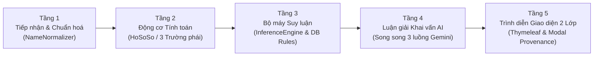

# BÁO CÁO TOÀN DIỆN VỀ HỆ THỐNG QUẢN LÝ TRI THỨC THẦN SỐ HỌC ĐA TRƯỜNG PHÁI (KMS)
> **Dự án:** KMS_project (NKMS — Knowledge Management System)  
> **Phiên bản:** 2.0 (Kiến trúc 5 Tầng, Đa trường phái, Giải thích 2 Lớp, Luận giải AI song song)  
> **Cơ sở dữ liệu:** Cụm phân tán TiDB Cloud (MySQL 8 tương thích)  

---

## MỤC LỤC
1. [Phần 1: Project này đang làm gì? (What is this project doing?)](#phần-1-project-này-đang-làm-gì-what-is-this-project-doing)
2. [Phần 2: Làm việc đó như thế nào? (How does it do it?)](#phần-2-làm-việc-đó-như-thế-nào-how-does-it-do-it)
3. [Phần 3: Dựa vào đâu để làm việc đó? (Based on what does it do it?)](#phần-3-dựa-vào-đâu-để-làm-việc-đó-based-on-what-does-it-do-it)
4. [Bảng đối chiếu tổng kết các thành phần hệ thống](#bảng-đối-chiếu-tổng-kết-các-thành-phần-hệ-thống)

---

## PHẦN 1: PROJECT NÀY ĐANG LÀM GÌ? (WHAT IS THIS PROJECT DOING?)

### 1. Bản chất cốt lõi của dự án
Project này là một **Hệ Thống Quản Lý Tri Thức (Knowledge Management System — KMS)** chuyên sâu về Thần số học (Numerology). 

Khác hoàn toàn với các trang web bói toán, thương mại hay phần mềm thần số học tự phát trên mạng (vốn thường chắp vá công thức, áp đặt bói toán định mệnh và giấu kín nguồn gốc), hệ thống này được xây dựng theo **chuẩn mực khoa học quản trị tri thức**:
- **Thu nhận & Mã hoá:** Chuyển hoá tri thức từ các công trình học thuật cổ điển thành các đơn vị tri thức số hoá có cấu trúc.
- **Đối chiếu Đa trường phái:** Đặt song song 3 hệ thống thần số học lớn trên thế giới (Pythagoras phương Tây, Vệ Đà Ấn Độ, Kabbalah Do Thái) để tìm ra điểm đồng thuận và khác biệt.
- **Quản trị Xung đột Tri thức:** Không tự ý phán quyết tác giả nào đúng/sai, mà ghi nhận tường minh các điểm dị biệt và thiết lập quy tắc xử lý minh bạch.
- **Giải mã Bản thể Cá nhân:** Cung cấp dịch vụ khai vấn tâm lý (Life Coach) ấm áp, sâu sắc, thực tế cho người dùng dựa trên chính hồ sơ năng lượng họ tên và ngày sinh.

---

### 2. Các sản phẩm và kết quả đầu ra cụ thể

#### A. Giao diện Khám phá & Luận giải Cuộc đời (`/kham-pha`)
Người dùng chỉ cần nhập **Họ và tên đầy đủ** cùng **Ngày tháng năm sinh**. Hệ thống sẽ tự động giải mã và giải đáp **3 câu hỏi lớn của cuộc đời**:
1. **"Tôi là ai?" (Bản ngã & Cốt cách):** 
   - Bản ngã cốt lõi & chân dung tâm lý.
   - Thế mạnh vượt trội & tài năng thiên bẩm.
   - Điểm mù tâm lý & mâu thuẫn nội tâm cần gỡ bỏ.
   - Định hướng hành động & môi trường phát triển lý tưởng.
2. **"Tôi đang gặp gì?" (Thời vận & Chu kỳ):** 
   - Bối cảnh năng lượng năm nay (Năm cá nhân & Năm Vệ Đà).
   - Cơ hội đột phá & đòn bẩy thuận lợi.
   - Cạm bẫy tâm lý & rủi ro cần cảnh giác.
   - Bài học giai đoạn độ tuổi & năng lượng đỉnh cao đời người.
3. **"Tôi nên đi thế nào?" (Kim chỉ nam & Hành động):** 
   - Kim chỉ nam sống & tư duy cốt lõi để an nhiên, vững vàng.
   - Hành động ưu tiên & kỷ luật tự thân cần bắt tay làm ngay.
   - Rào cản tư duy & thói quen xấu cần buông bỏ.
   - Chiến lược dài hạn để khai phóng trọn vẹn tiềm năng.

#### B. Mô hình Giao diện Giải thích 2 Lớp (Explainable KMS UI)
- **Lớp 1 (User-facing):** Trình bày 4 trụ cột khai vấn bằng lời văn gần gũi, ấm áp, hoàn toàn trung tính về giới tính, súc tích (80–110 từ/thẻ), không chèn thuật ngữ học thuật khô khan.
- **Lớp 2 (Academic Transparency / Audit Trail):** Bên cạnh mỗi câu hỏi là các chip chỉ số giải đáp (Số chủ đạo, Ngày sinh, Linh hồn, Biểu đạt, Tâm hồn Vệ Đà, Định mệnh, Số chìa khoá Kabbalah...). Khi người dùng **click vào bất kỳ chỉ số nào**, một Modal sẽ mở ra hiển thị:
  - *Công thức toán học & Điều kiện kích hoạt.*
  - *Các bước tính trung gian từ dữ liệu thực tế của họ.*
  - *Tác phẩm, tác giả, nhà xuất bản, chương và số trang sách gốc tham chiếu.*
  - *Định dạng trích dẫn học thuật chuẩn APA có nút sao chép tức thì.*

#### C. Các phân hệ Quản trị Tri thức Chuyên sâu
- **Kho Tri Thức (`/kho`):** Quản lý toàn diện các hạt tri thức theo vòng đời: *Bản thảo -> Chờ duyệt -> Đã duyệt -> Lưu trữ*, tích hợp lưu vết lịch sử phiên bản (`LichSuPhienBan`).
- **Cơ Chế Quản Trị Xung Đột (`/xung-dot`):** Quản trị 14 xung đột học thuật giữa các trường phái theo 3 chiến lược: *Chuẩn hoá Thực thể*, *Tách biệt Ngữ cảnh*, và *Đa nguyên Đối chiếu*.
- **Chuẩn Hoá Khái Niệm (`/khai-niem`):** Bản thể học (Ontology) ánh xạ các thuật ngữ dị biệt giữa các tác giả (*Ruling Number*, *Life Path*, *Destiny Number*, *Key Number*...) về chung một khái niệm nền tảng.
- **Nguồn Sách Gốc (`/nguon`):** Hồ sơ trích dẫn 5 bộ sách gốc đã thẩm định và quy tắc kiểm soát phạm vi nguồn.
- **Thống Kê Tri Thức (`/thong-ke`):** Báo cáo định lượng độ phủ tri thức, tỷ lệ duyệt, độ tin cậy và phân bổ nhãn thẻ.

---

## PHẦN 2: LÀM VIỆC ĐÓ NHƯ THẾ NÀO? (HOW DOES IT DO IT?)

Hệ thống vận hành thông qua quy trình kỹ thuật **5 Tầng khép kín**:

---

### Tầng 1: Tiếp nhận và Chuẩn hoá Dữ liệu (Input & Normalization)
- **Tệp xử lý chính:** [`NameNormalizer.java`](file:///c:/Users/MinhNgoc/Desktop/KMS_project/src/main/java/com/kms301/nkms/engine/NameNormalizer.java), [`DateValidator.java`](file:///c:/Users/MinhNgoc/Desktop/KMS_project/src/main/java/com/kms301/nkms/engine/DateValidator.java).
- **Cách thức hoạt động:**
  1. Người dùng gửi Họ tên và Ngày sinh qua giao diện.
  2. `DateValidator` kiểm tra tính hợp lệ của chuỗi ngày sinh (định dạng `dd/MM/yyyy`, kiểm tra năm nhuận, chặn ngày tương lai hoặc người chưa sinh).
  3. `NameNormalizer` làm sạch khoảng trắng, bóc tách cấu trúc tên người Việt thành: *Họ*, *Tên đệm*, *Tên gọi*.
  4. Ánh xạ các ký tự chữ cái thành giá trị số nguyên:
     - Hệ thống Pythagoras: Bảng số học 1–9 tiêu chuẩn.
     - Hệ thống Chaldean / Vệ Đà: Bảng số học 1–8 (không có số 9 do coi số 9 là thiêng liêng).
     - Hỗ trợ nạp bảng chữ cái tuỳ chỉnh (`UNIT_SYSTEM`) từ CSDL thay vì viết cứng trong mã nguồn.

---

### Tầng 2: Động cơ Tính toán Đa trường phái (Calculation Engine)
- **Tệp xử lý chính:** [`HoSoSo.java`](file:///c:/Users/MinhNgoc/Desktop/KMS_project/src/main/java/com/kms301/nkms/engine/HoSoSo.java), [`NumberReducer.java`](file:///c:/Users/MinhNgoc/Desktop/KMS_project/src/main/java/com/kms301/nkms/engine/NumberReducer.java), và các Calculator trong `com.kms301.nkms.engine.*`.
- **Cách thức hoạt động:**
  Động cơ Java thuần tính toán độc lập hơn 20 chỉ số theo đúng công thức của từng tác giả:
  - **Nhánh Pythagoras phương Tây ([`QhCalculator.java`](file:///c:/Users/MinhNgoc/Desktop/KMS_project/src/main/java/com/kms301/nkms/engine/pythagoras/QhCalculator.java)):**
    - *Con số chủ đạo (Ruling Number):* Cộng tổng ngày + tháng + năm sinh rút gọn về 2..11 và 22/4.
    - *Con số ngày sinh:* Rút gọn ngày sinh trong tháng.
    - *Con số linh hồn:* Tổng các nguyên âm trong tên.
    - *Con số biểu đạt:* Tổng các phụ âm trong tên.
    - *Biểu đồ ngày sinh ([`BirthChart.java`](file:///c:/Users/MinhNgoc/Desktop/KMS_project/src/main/java/com/kms301/nkms/engine/pythagoras/BirthChart.java)):* Điền các chữ số vào ma trận 3x3, xác định các mũi tên sức mạnh (4-5-6 Thực tế, 1-2-3 Kế hoạch...) hoặc mũi tên trống (7-8-9 Thụ động, 1-4-7 Hỗn loạn...), tự động tính toán bù số ảo bằng tên riêng.
    - *Chu kỳ 9 năm & 4 Đỉnh Kim tự tháp:* Tính tuổi chạm đỉnh và con số thử thách/thành tựu cho 4 giai đoạn cuộc đời.
  - **Nhánh Pythagoras Mỹ ([`DecozCalculator.java`](file:///c:/Users/MinhNgoc/Desktop/KMS_project/src/main/java/com/kms301/nkms/engine/pythagoras/DecozCalculator.java)):**
    - Tính số *Đường đời (Life Path)* bằng cách rút gọn riêng Ngày, Tháng, Năm trước khi cộng dồn (quy tắc phát hiện số Nợ nghiệp Karmic Debt: 13/4, 14/5, 16/7, 19/1).
  - **Nhánh Ấn Độ / Vệ Đà ([`JohariCalculator.java`](file:///c:/Users/MinhNgoc/Desktop/KMS_project/src/main/java/com/kms301/nkms/engine/veda/JohariCalculator.java)):**
    - *Số Tâm hồn (Psychic Number):* Rút gọn ngày sinh về 1..9, gắn liền với 1 trong 9 hành tinh (Thái dương, Thái âm, Mộc tinh, Rahu, Thủy tinh, Kim tinh, Ketu, Thổ tinh, Hỏa tinh).
    - *Số Định mệnh (Destiny Number):* Rút gọn toàn bộ ngày tháng năm sinh.
    - Đánh giá tương quan Bạn — Thù — Trung tính giữa 2 hành tinh chủ quản.
    - *Số Năm Vệ Đà:* Tính biến thiên nhịp vận chuyển giao theo thời điểm sinh nhật.
  - **Nhánh Kabbalah / Chaldean ([`SepharialCalculator.java`](file:///c:/Users/MinhNgoc/Desktop/KMS_project/src/main/java/com/kms301/nkms/engine/kabbalah/SepharialCalculator.java)):**
    - *Số Chìa khoá (Key Number):* Cộng ngày + tháng + 2 chữ số cuối của năm sinh (quy tắc bỏ thế kỷ của Sepharial).
    - *Ma phương 3 tầng:* Phân bổ các con số vào 3 tầng: Thể xác (1, 4, 7), Trí tuệ (2, 5, 8), Tinh thần (3, 6, 9) để tìm ra tầng năng lượng ưu thế.

Toàn bộ kết quả được gom vào thực thể `HoSoSo` (tồn tại trong bộ nhớ RAM của phiên request, tuyệt đối không lưu họ tên/ngày sinh vào DB để bảo vệ quyền riêng tư người dùng).

---

### Tầng 3: Kho Tri Thức CSDL & Bộ Máy Suy Luận (Inference Engine)
- **Tệp xử lý chính:** [`KhamPhaService.java`](file:///c:/Users/MinhNgoc/Desktop/KMS_project/src/main/java/com/kms301/nkms/service/KhamPhaService.java), [`InferenceEngine.java`](file:///c:/Users/MinhNgoc/Desktop/KMS_project/src/main/java/com/kms301/nkms/inference/InferenceEngine.java), [`RuleEvaluator.java`](file:///c:/Users/MinhNgoc/Desktop/KMS_project/src/main/java/com/kms301/nkms/inference/RuleEvaluator.java).
- **Cách thức hoạt động:**
  1. `KhamPhaService` truy vấn từ CSDL TiDB Cloud danh sách các Đơn vị tri thức có trạng thái `DA_DUYET` và nhãn sử dụng `DUNG` hoặc `GOI_Y_VAN_HOA`.
  2. `RuleEvaluator` đọc biểu thức logic JSON trong trường `dieu_kien_kich_hoat` (ví dụ: `{"con_so_chu_dao": 10, "mui_ten_co": ["4-5-6"]}`) và so khớp với `HoSoSo`.
  3. `InferenceEngine` phân loại các đơn vị tri thức khớp vào 3 nhóm câu hỏi ("Tôi là ai?", "Tôi đang gặp gì?", "Tôi nên đi thế nào?").
  4. Áp dụng quy tắc ngoại lệ/tinh chỉnh: Nếu hồ sơ có mũi tên trống nhưng tên riêng bù được số ảo, hệ thống tự động ghi nhận cơ chế "Phá thế".
  5. Đóng gói kết quả thành đối tượng [`KhamPhaResult.java`](file:///c:/Users/MinhNgoc/Desktop/KMS_project/src/main/java/com/kms301/nkms/inference/KhamPhaResult.java).

---

### Tầng 4: Diễn Giải & Khai Vấn Tâm Lý AI Cá Nhân Hoá (Life Coach Layer)
- **Tệp xử lý chính:** [`AiAnalysisService.java`](file:///c:/Users/MinhNgoc/Desktop/KMS_project/src/main/java/com/kms301/nkms/service/AiAnalysisService.java), [`AiAnalysisDto.java`](file:///c:/Users/MinhNgoc/Desktop/KMS_project/src/main/java/com/kms301/nkms/model/dto/AiAnalysisDto.java).
- **Cách thức hoạt động:**
  1. **Gọi song song 3 luồng độc lập (`CompletableFuture`):** Thay vì gửi 1 prompt dài bắt AI viết cả 15 mục (mất 22–25 giây), hệ thống tách thành 3 prompt ngắn tương ứng với 3 câu hỏi chạy song song, giảm thời gian phản hồi xuống chỉ còn **~3 giây**.
  2. **Tối ưu hoá mô hình:** Sử dụng mô hình tốc độ cao `gemini-3.5-flash-lite`, tích hợp cơ chế tự động luân chuyển dự phòng (nếu gặp lỗi 503/429 sẽ tự chuyển sang `gemini-3.1-flash-lite` hoặc `gemini-3-flash-preview`).
  3. **Kiểm soát chặt chẽ biên giới tri thức:**
     - Prompt ép buộc AI: *Chỉ được phép sử dụng các con số và chỉ số đã tính toán ở Tầng 2 & 3.*
     - *Nghiêm cấm tuyệt đối* đưa vào các yếu tố ngoại lai như 12 cung hoàng đạo Tây phương, bói bài Tarot, phong thuỷ ngũ hành, tử vi.
     - *Không chèn trích dẫn học thuật* vào văn phong người dùng (không nói "theo Pythagoras", "theo Harish Johari"...).
  4. **Trung tính giới tính 100%:**
     - Hệ thống hoàn toàn phi giới tính.
     - Prompt cấm suy đoán giới tính qua họ tên (cấm dùng "anh", "chị", "ông", "bà", "nam", "nữ"...), chỉ dùng xưng hô thân mật: "tôi" – "bạn".
     - Backend bổ sung hàm khử thiên kiến bằng Regex `sanitizeGenderPronouns(text)` để chặn đứng mọi từ ngữ giới tính vô tình lọt vào.
  5. **Bộ tổng hợp dự phòng nội bộ (`buildSynthesizedFallback`):** Nếu mất mạng hoàn toàn hoặc không có API key, hệ thống tự động sinh luận giải có cấu trúc từ mã Java, đảm bảo web không bao giờ bị gián đoạn.

---

### Tầng 5: Trình Diễn Tương Tác 2 Lớp (Interactive Explainable Presentation)
- **Tệp xử lý chính:** [`kham-pha.html`](file:///c:/Users/MinhNgoc/Desktop/KMS_project/src/main/resources/templates/kham-pha.html), [`fragments/layout.html`](file:///c:/Users/MinhNgoc/Desktop/KMS_project/src/main/resources/templates/fragments/layout.html).
- **Cách thức hoạt động:**
  - Form tra cứu sử dụng JavaScript AJAX (`fetch`) kết hợp hiệu ứng thanh tiến trình giải mã (1% đến 100%), không làm giật trang.
  - Giao diện 4 thẻ khai vấn hiển thị cô đọng (80–110 từ/thẻ), tiêu đề thẻ tự động biến đổi phù hợp theo từng câu hỏi (Bản ngã / Thời vận / Kim chỉ nam).
  - Từng chip con số giải đáp được gắn kèm các thuộc tính dữ liệu `data-*` (`data-formula`, `data-steps`, `data-book`, `data-author`, `data-chapter`, `data-apa`).
  - Khi người dùng nhấp chuột, hàm JavaScript `inspectKnowledgeCard(this)` lập tức mở Modal Lớp 2 tra cứu nguồn gốc học thuật mà không cần gọi lại máy chủ.

---

## PHẦN 3: DỰA VÀO ĐÂU ĐỂ LÀM VIỆC ĐÓ? (BASED ON WHAT DOES IT DO IT?)

Hệ thống được xây dựng trên **2 trụ cột nền tảng vững chắc**:

---

### Trụ cột 1: Nguồn Tri Thức Học Thuật Gốc (5 Bộ Sách Kinh Điển)
Hệ thống không thu thập dữ liệu rác trên mạng mà mã hoá trực tiếp từ **5 công trình nguyên bản** của các học giả hàng đầu thế giới:

| STT | Trường phái | Tác phẩm tham chiếu chính | Tác giả & Năm xuất bản | Nhà xuất bản / Định danh |
|:---:|:---|:---|:---|:---|
| 1 | **Pythagoras phương Tây** | *The Complete Book of Numerology* | David A. Phillips, Ph.D. (1980/2005) | Hay House Inc. (ISBN: 978-1-4019-0806-5) |
| 2 | **Pythagoras (Bản địa hoá VN)** | *Thay Đổi Cuộc Sống Với Nhân Số Học* | Lê Đỗ Quỳnh Hương (2020) | NXB Tổng hợp TP.HCM & First News (Kế thừa ~60% hệ thống Phillips) |
| 3 | **Pythagoras nhánh Mỹ** | *Numerology: Key to Your Inner Self* | Hans Decoz & Monte Farber (1994/2002) | Avery Publishing / Penguin Group (ISBN: 978-0-399-52781-4) |
| 4 | **Ấn Độ / Vệ Đà** | *Numerology: With Tantra, Ayurveda, and Astrology* | Harish Johari (1990/2012) | Destiny Books, Vermont (ISBN: 978-0-89281-258-5) |
| 5 | **Kabbalah / Chaldean** | *The Kabala of Numbers (Part I & II)* | Sepharial — Walter Gorn Old (1911/1920) | William Rider & Son, London (Tác phẩm kinh điển Public Domain) |

#### Quy tắc kiểm soát phạm vi nguồn (Scope Control):
Hệ thống có văn bản loại trừ tường minh đối với:
- *Brihat Parashara Hora Shastra (BPHS):* Đây là chiêm tinh học Vệ Đà (Jyotish) cần giờ sinh chính xác và toạ độ các chòm sao, không phải thần số học tính theo họ tên và ngày sinh.
- *Sefer Yetzirah:* Đây là triết học vũ trụ luận Kabbalah cổ đại về 10 Sefirot và 22 mẫu tự Do Thái, không phải công cụ tra cứu số học ứng dụng.
- *12 cung hoàng đạo Tây phương, Tarot, bói bài, tử vi tướng số:* Hoàn toàn nằm ngoài phạm vi tri thức của hệ thống.

---

### Trụ cột 2: Cơ Sở Lý Thuyết Quản Trị Tri Thức (KMS Principles)

Hệ thống tuân thủ nghiêm ngặt các nguyên lý của khoa học Quản trị Tri thức (Knowledge Management):

#### 1. Cơ chế Điều phối và Hoà hợp Xung đột Tri thức (Knowledge Harmonization)
Khi các trường phái hoặc tác giả bất đồng quan điểm, hệ thống **không chọn bên thắng/thua** mà áp dụng 3 chiến lược khoa học được quản trị tại trang `/xung-dot`:
- **Chuẩn hoá Thực thể (Ontological Harmonization):** Các tác giả dùng nhiều thuật ngữ khác nhau cho cùng một bản chất (*Con số chủ đạo* của Phillips = *Đường đời* của Decoz = *Số định mệnh* của Johari = *Số chìa khoá* của Sepharial). Hệ thống ánh xạ chúng về một khái niệm gốc trong bảng `khai_niem` và `dong_nghia`.
- **Tách biệt Ngữ cảnh (Contextual Partitioning):** Chu kỳ thời vận Pythagoras tính theo năm dương lịch tự nhiên (1/1 đến 31/12), trong khi chu kỳ Vệ Đà tính theo nhịp ngày sinh nhật. Hệ thống phân định rõ ngữ cảnh để cả hai cùng tồn tại chính xác.
- **Đa nguyên Đối chiếu (Pluralistic Coexistence):** Hiển thị song song sự khác biệt (ví dụ: Phillips tính số 22 là 22/4, Decoz giữ 22 Master; Johari luôn rút về 1–9) kèm số trang sách gốc để người dùng tự chiêm nghiệm.

#### 2. Tính Giải trình được và Minh bạch Nguồn gốc (Explainability & Provenance)
Mọi kết quả hiển thị trên màn hình đều có thể truy vết ngược (Traceability):
$$\text{Kết quả hiển thị} \longrightarrow \text{Quy tắc so khớp} \longrightarrow \text{Công thức toán học} \longrightarrow \text{Trang sách gốc (Provenance)}$$
Người dùng và hội đồng thẩm định học thuật có thể kiểm tra tính chân xác của bất kỳ phát ngôn nào thông qua Modal Lớp 2.

#### 3. Quản trị Chất lượng và Vòng đời Tri thức (Knowledge Quality Lifecycle)
Mỗi đơn vị tri thức trong CSDL đều được quản lý với các thuộc tính kiểm soát:
- *Trạng thái:* `BAN_THAO` $\rightarrow$ `CHO_DUYET` $\rightarrow$ `DA_DUYET` $\rightarrow$ `LUU_TRU`.
- *Nhãn sử dụng:* `DUNG` (chuẩn mực), `GOI_Y_VAN_HOA` (tham khảo), `CAN_NHAC` (chưa đồng thuận cao).
- *Lưu vết:* Ghi nhận người tạo, người duyệt, ngày cập nhật và lịch sử thay đổi qua bảng `lich_su_phien_ban`.

---

## BẢNG ĐỐI CHIẾU TỔNG KẾT CÁC THÀNH PHẦN HỆ THỐNG

| Câu hỏi lớn | Khía cạnh giải quyết | Thành phần kỹ thuật đảm nhiệm | Căn cứ nguồn gốc |
|---|---|---|---|
| **PROJECT LÀM GÌ?** | Giải mã bản thể cá nhân qua họ tên & ngày sinh; cung cấp luận giải khai vấn 3 câu hỏi; quản trị tri thức đa trường phái minh bạch 2 lớp. | - `KhamPhaController.java` - `kham-pha.html` - `KhoController.java` - `TrangPhuController.java` | - Học phần KMS301 - Nhu cầu khai phóng tiềm năng cá nhân và định hướng cuộc đời. |
| **LÀM NHƯ THẾ NÀO?** | Quy trình 5 tầng: Chuẩn hoá dữ liệu $\rightarrow$ Tính toán hơn 20 chỉ số $\rightarrow$ So khớp luật DB $\rightarrow$ Luận giải AI song song ~3s $\rightarrow$ Giao diện giải thích 2 Lớp. | - `NameNormalizer.java` - `HoSoSo.java` & Calculators - `InferenceEngine.java` - `AiAnalysisService.java` - `layout.html` (Modal Lớp 2) | - Ngôn ngữ Java 17, Spring Boot 3 - Cơ sở dữ liệu TiDB Cloud (Flyway V1–V7) - Mô hình Google Gemini qua API song song. |
| **DỰA VÀO ĐÂU?** | - 5 bộ sách kinh điển của David Phillips, Quỳnh Hương, Hans Decoz, Harish Johari, Sepharial. - Lý thuyết Quản trị Tri thức: Harmonization, Provenance, Scope Control, Lifecycle Management. | - CSDL bảng `nguon_sach` - Bảng `xung_dot` (14 bản ghi) - Bảng `don_vi_tri_thuc` - `ThongKeService.java` | - Trích dẫn chuẩn APA số trang sách cụ thể. - Nguyên tắc phi bói toán, phi mê tín, tôn trọng bản quyền học thuật. |
